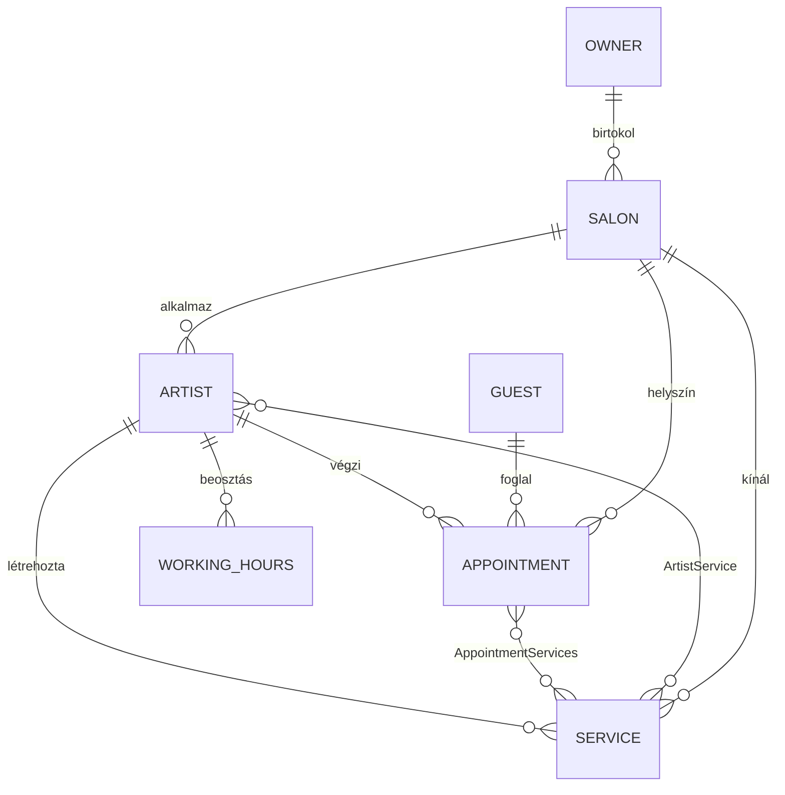

# FoglalóPlusz — Teljes projektdokumentáció

**Projekt neve:** FoglalóPlusz  
**Verzió:** a jelen dokumentáció írásakor a tárolóban lévő fejlesztői állapot  
**Készítette:** Kevin és Dori (kb. **50–50%** arányban közös munka)  
**Nyelv:** magyar  
**Formátum:** Markdown; mellékelt **Word:** `Foglaloplusz_Dokumentacio.docx` (Pandoc export ugyanebből a fájlból). PDF: lásd a 14. függelék.

> **Megjegyzés a terjedelemhez (~80 oldal, ±10):** A tiszta szöveges rész és a táblázatok jelentős terjedelmet adnak. A céloldalszám eléréséhez illessz be **25–40 képernyőképet** az alábbi „**[KÉPERNYŐKÉP HELYE]**” blokkokba: egy átlagos A4-es PDF-ben egy ábra + felirat gyakran **fél–egy oldalt** foglal. A Pandoc / Word PDF exportnál a fejezetek tördelése és a margók is befolyásolják az oldalszámot.

---

## Tartalomjegyzék

1. [Bevezetés](#1-bevezetés)  
2. [A projekt célja, célcsoport, hatókör, áttekintés](#2-a-projekt-célja-célcsoport-hatókör-áttekintés)  
3. [Specifikáció](#3-specifikáció)  
4. [Fejlesztési módszertan és csapatmunka](#4-fejlesztési-módszertan-és-csapatmunka)  
5. [Rendszeráttekintés](#5-rendszeráttekintés)  
6. [Telepítési útmutató](#6-telepítési-útmutató)  
7. [Használati útmutató](#7-használati-útmutató)  
8. [API dokumentáció](#8-api-dokumentáció)  
9. [Adatbázis dokumentáció](#9-adatbázis-dokumentáció)  
10. [Tesztelés](#10-tesztelés)  
11. [Üzembe helyezés (deployment)](#11-üzembe-helyezés-deployment)  
12. [Jövőbeli fejlesztési lehetőségek](#12-jövőbeli-fejlesztési-lehetőségek)  
13. [Felhasznált források](#13-felhasznált-források)  
14. [Függelék: PDF generálás](#14-függelék-pdf-generálás)

---

## 1. Bevezetés

### 1.1 Mi a FoglalóPlusz?

A **FoglalóPlusz** egy **fodrász-/szépségszalonok** számára készült **webes alkalmazás**, amely összekapcsolja a **szalon tulajdonosát**, az **alkalmazott művészeket (szakembereket)** és a **vendégeket**. A rendszer lehetővé teszi a szalonok és szolgáltatások kezelését, a munkaidő beállítását, valamint a vendégek számára **időpontfoglalást** szabad slotok alapján.

### 1.2 Miért készült?

A hagyományos telefonos vagy papír alapú foglalás helyett egy **központi, digitális** megoldás kínál:

- átlátható **naptár** és **elérhető idősávok**;
- **szerepkörök szerinti** felület (tulajdonos, művész, vendég);
- **REST API**-n keresztüli bővíthetőség és automatizálhatóság.

### 1.3 Dokumentáció célja és olvasói

Ez a dokumentáció a projekt **teljes technikai és felhasználói** bemutatását adja: architektúra, technológiai stack, telepítés, használat, API, adatmodell és tesztelési szemlélet. Célzott olvasók: **fejlesztők**, **üzemeltetők**, **oktatók/értékelők** (pl. beadandó dokumentáció), illetve a csapat **jövőbeli bővítése**.

### 1.4 Szerzők és hozzájárulás

A fejlesztést **Kevin** és **Dori** végezte; a munkamegosztás **körülbelül egyenlő (50–50%)** volt a projekt egészében (backend, frontend, adatbázis, integráció, dokumentációs feladatok koordinált megosztása).

---

## 2. A projekt célja, célcsoport, hatókör, áttekintés

### 2.1 A projekt célja

**Elsődleges cél:** egy működő, **többszereplős** szalonkezelő és foglaló rendszer biztosítása, amely:

- regisztrációt és bejelentkezést ad **vendég**, **művész** és **tulajdonos** szerepkörökben;
- JWT alapú **biztonságos API**-t kínál;
- MySQL adatbázisban tárolja az üzleti adatokat;
- statikus HTML/JS frontendet szolgál ki egy **Express** szervert használva, amely a backend API-hoz csatlakozik.

### 2.2 Célcsoport (target audience)

| Szereplő | Szükségletek |
|----------|----------------|
| **Szalon tulajdonos** | Több szalon létrehozása (ahol a funkciók ezt támogatják), művészek áttekintése, heti nézet, foglalások listázása. |
| **Művész / szakember** | Saját szolgáltatások, munkaidő, elérhetőség kezelése. |
| **Vendég** | Regisztráció, bejelentkezés, szabad időpontok lekérdezése, foglalás. |
| **Fejlesztő / integrátor** | Swagger, REST végpontok, JSON szerződések. |

### 2.3 Hatókör (scope)

**A hatókörbe tartozik:**

- ASP.NET Core **Web API** (.NET 8), Entity Framework Core, **MySQL** (Pomelo provider);
- **réteges** felépítés: **DAL** (adat), **BLL** (üzleti logika, DTO), **Presentation** (vezérlők);
- **JWT** hitelesítés, szerepkör-alapú jogosultság;
- **Express** alapú frontend kiszolgáló, több HTML nézet, kliens oldali `fetch` hívások;
- szalon **logó** feltöltése (fájl tárolás), statikus `wwwroot` kiszolgálás.

**A hatókörön kívül eshet (nem része garantáltan a leírásnak), ha a termék nem implementálja:**

- mobil natív alkalmazás;
- fizetési gateway;
- teljes körű e-mail/SMS értesítés;
- automatizált unit teszt futtatás CI-ben (a tárolóban jelenleg nincs külön tesztprojekt).

### 2.4 Általános alkalmazásáttekintés

A felhasználó böngészőben megnyitja az Express által kiszolgált oldalt (a fejlesztői konfiguráció szerint például egy alacsony porton). Az oldalak JavaScriptből a **HTTPS-en futó ASP.NET API**-t hívják (fejlesztői példa: `https://localhost:7156`). A bejelentkezés után a kliens **Bearer JWT** tokent küld az `Authorization` fejlécben. Az adatok **MySQL** adatbázisban tárolódnak.

**[KÉPERNYŐKÉP HELYE — 1]**  
*Javasolt felirat: „A FoglalóPlusz fő áramlása: böngésző → Express (statikus UI) → ASP.NET Core API → MySQL.”*  
*(Illessz ide architektúra-vázlatot vagy egyszerű blokkdiagramot exportból.)*

---

## 3. Specifikáció

### 3.1 Technológiák és függőségek

#### 3.1.1 Backend (FoglalóPlusz presentation réteg)

| Technológia | Verzió (csproj szerint) | Szerep |
|-------------|-------------------------|--------|
| **.NET** | `net8.0` | Futási környezet |
| **ASP.NET Core** | OpenAPI/Swagger integráció | REST API |
| **Microsoft.EntityFrameworkCore** | 8.0.24 | ORM |
| **Pomelo.EntityFrameworkCore.MySql** | 8.0.3 | MySQL szolgáltató |
| **AutoMapper** | 16.0.0 | Entitás ↔ DTO leképezés |
| **JWT Bearer** | 8.0.25 | Hitelesítés |
| **Swashbuckle.AspNetCore** | 6.9.0 | Swagger UI |
| **System.IdentityModel.Tokens.Jwt** | 8.16.0 | Token kezelés |

#### 3.1.2 Üzleti logika (Foglaloplusz.BLL)

| Csomag | Szerep |
|--------|--------|
| **AutoMapper** | Profilok a DTO-khoz |
| **Microsoft.EntityFrameworkCore.Relational** | Lekérdezésekhez szükséges típusok |
| **System.IdentityModel.Tokens.Jwt** | JWT építéshez kapcsolódó típusok (rétegfüggés szerint) |

#### 3.1.3 Adatelérési réteg (Foglaloplusz.DAL)

| Csomag | Szerep |
|--------|--------|
| **Microsoft.EntityFrameworkCore** | `DbContext`, migrációk |
| **Pomelo.EntityFrameworkCore.MySql** | MySQL |

#### 3.1.4 Frontend (Express)

| Technológia | Megjegyzés |
|-------------|------------|
| **Node.js** | futtatókörnyezet |
| **Express** `^5.2.1` | statikus fájlok és útvonalak kiszolgálása |
| **Natív JavaScript** (`fetch`) | API hívások (`public/api.js`, `script.js`, stb.) |

### 3.2 A projekt célkitűzése: funkcionális követelmények

Az alábbiak a kódbázis alapján **implementált vagy részben implementált** funkcionális elvárások összegzése.

| Azonosító | Követelmény | Megvalósítás jele |
|-----------|-------------|-------------------|
| F-01 | Vendég regisztráció | `POST /api/register/guest` |
| F-02 | Művész regisztráció | `POST /api/register/artist` |
| F-03 | Tulajdonos regisztráció | `POST /api/register/owner` |
| F-04 | Bejelentkezés szerepkörrel | `POST /api/authentication/authenticate` |
| F-05 | JWT alapú védett műveletek | `[Authorize(Roles=...)]` |
| F-06 | Szalon létrehozása (tulajdonos), opcionális logó | `POST /api/salon` (multipart) |
| F-07 | Szalonok listázása tulajdonosnak | `GET /api/salon/my` |
| F-08 | Szalon törlése | `DELETE /api/salon/{id}` |
| F-09 | Szalon létezés ellenőrzés | `GET /api/salon/{id}/exists` |
| F-10 | Művészek listája szalonhoz (tulaj) | `GET /api/salon/{id}/artists` |
| F-11 | Művész heti ütemezés (tulaj) | `GET /api/salon/.../schedule` |
| F-12 | Szolgáltatások listája szalonhoz (publikus) | `GET /api/salon/{id}/services` |
| F-13 | Művész saját szolgáltatásai / létrehozás | `GET/POST /api/Artist/services` |
| F-14 | Munkaidő beállítás (művész) | `POST /api/workinghours`, `POST /api/workinghours/schedule`, `PATCH /api/workinghours/range` |
| F-15 | Havi nap szintű elérhetőség | `POST /api/availability/month` |
| F-16 | Szabad idősávok (vendég foglalás előtt) | `PATCH /api/appointment/available` |
| F-17 | Foglalás létrehozása vendégként | `POST /api/appointment` |
| F-18 | Foglalások listája vendégnek / tulajnak | `GET /api/appointment/guest`, `GET /api/appointment/salon/{id}` |
| F-19 | Foglalási megjelenítő nevek lekérdezése | `POST /api/lookup/names` |
| F-20 | Profil lekérdezés | `GET /api/guest/me`, `GET /api/owner/me`, `GET /api/Artist/me` |

### 3.3 Nem funkcionális követelmények

| Típus | Elvárás | Megjegyzés |
|-------|----------|------------|
| **Biztonság** | Jelszavak és tokenek kezelése | JWT, szerepkörök; jelszavak tárolása a jelen modellben hash nélküli szövegként is szerepelhet a DAL-ben — **éles rendszerben hash kötelező** (lásd jövőbeli fejezet). |
| **Skálázhatóság** | Réteges architektúra | Külön DAL/BLL/API. |
| **Karbantarthatóság** | DTO-k, interfészek, migrációk | EF migrációk a DAL-ben. |
| **Interop** | CORS | `AllowAll` politika — fejlesztésre egyszerűsített; élesben szűkíteni kell. |
| **Dokumentálhatóság** | Swagger (Development) | `UseSwagger` / `UseSwaggerUI` fejlesztői környezetben. |

### 3.4 Implementált fő funkciók (összefoglaló)

1. **Felhasználókezelés:** három külön táblában tárolt szerepkör (Guest, Artist, Owner), egységes bejelentkezési végpont szerepkör-paraméterrel.  
2. **Szalonéletciklus:** létrehozás, listázás, törlés, művészek és heti nézet.  
3. **Szolgáltatások:** szalonhoz kötött szolgáltatások, művész általi létrehozás.  
4. **Időbeosztás:** napi és sávos munkaidő, havi elérhetőség, szabad slotok számítása.  
5. **Foglalás:** több szolgáltatás egy foglalásban (ID lista), időtartam összegzése alapján.  

**[KÉPERNYŐKÉP HELYE — 2]**  
*Swagger UI áttekintés (Development mód): végpontok listája.*

---

## 4. Fejlesztési módszertan és csapatmunka

### 4.1 Agile elemek (mit használtunk, és hogyan)

A kétfős csapatnál nem egy teljes „enterprise” Scrum volt jellemző, hanem az **agile eszmék** átvétele:

| Agile elem | Alkalmazás a projektben |
|------------|-------------------------|
| **Iteratív fejlesztés** | Funkciók szeletekben: auth → szalon → szolgáltatás → munkaidő → foglalás. |
| **Rövid visszacsatolási ciklus** | API változás → frontend hívás frissítése; közös próba a böngészőben. |
| **Egyszerű feladatfelosztás** | Kevin és Dori közel azonos mértékben vállalt modulokat (50–50%). |
| **Átlátható backlog jelleg** | Funkciólista (lásd specifikáció táblázatok) követése. |
| **Retrospektíva jellegű javítás** | Ha egy integrációs pont (CORS, token, dátumformátum) hibázott, azonnali korrekció. |

### 4.2 Együttműködést támogató eszközök

| Eszköz / módszer | Cél |
|------------------|-----|
| **Git / verziókezelő** | párhuzamos fejlesztés, branch-ek |
| **IDE (Visual Studio / VS Code)** | C# és JS szerkesztés, debug |
| **Swagger** | API szerződés egyeztetése |
| **Közös adatbázis / connection string** | fejlesztői teszt (ügyelj a titkok védelmére!) |

### 4.3 Csapatszerepek

| Név | Fő szerepkörök (átfogóan) |
|-----|---------------------------|
| **Kevin** | Backend és frontend feladatok, API és UI integráció, tesztelés — **~50%** részvétel. |
| **Dori** | Adatmodell / migrációk, üzleti logika, frontend oldalak, dokumentációs részek — **~50%** részvétel. |

> A pontos commit-statisztika változhat; a **munkamegosztás elve** az egyenlő mértékű hozzájárulás volt a projekt egészéhez.

**[KÉPERNYŐKÉP HELYE — 3]**  
*Git history / branch stratégia (opcionális ábra).*

---

## 5. Rendszeráttekintés

### 5.1 Architektúra magyarázata

A rendszer **három fő komponensre** bontható:

```
┌─────────────────┐     HTTPS      ┌──────────────────────┐     SQL      ┌─────────┐
│  Böngésző (UI)  │ ─────────────► │ ASP.NET Core Web API │ ───────────► │  MySQL  │
│  Express static │   REST + JWT   │  FoglalóPlusz + DAL + BLL │            │         │
└─────────────────┘                └──────────────────────┘            └─────────┘
```

1. **Prezentáció (kliens):** HTML + CSS + JavaScript, Express által kiszolgált fájlok.  
2. **Alkalmazás réteg:** MVC vezérlők, DI konténer, JWT auth, CORS, Swagger.  
3. **Üzleti logika:** szolgáltatásosztályok (pl. `AppointmentService`, `AvailabilityService`).  
4. **Adat:** EF Core `AppDbContext`, repository minta, migrációk.  
5. **Fájlok:** szalon logók mentése és `wwwroot` alatti statikus kiszolgálás.

### 5.2 Rétegek és függőségek

- **FoglalóPlusz (presentation):** Controllers, `Program.cs`, `SalonCreateForm` modell.  
- **Foglaloplusz.BLL:** interfészek, implementációk, DTO-k, AutoMapper profilok.  
- **Foglaloplusz.DAL:** `AppDbContext`, entitások, repository-k, migrációk.

### 5.3 Hitelesítés (JWT)

- **Séma:** HTTP Bearer.  
- **Claims:** `sub` (felhasználó numerikus ID), `email`, `role` (`guest` / `artist` / `owner`).  
- **Élettartam:** a kódban kb. **1 óra** (`DateTime.UtcNow.AddHours(1)`).  
- **Konfiguráció:** `Authentication:Issuer`, `Authentication:Audience`, `Authentication:SecretForKey` (Base64 kulcs).

### 5.4 Deployment környezet (opcionális áttekintés)

**Fejlesztői környezet jellemzői:**

- Backend: `https://localhost:7156` és `http://localhost:5181` (`launchSettings.json`).  
- Frontend Express: a `server.js` szerint a **PORT = 67** (ez nem szabványos; élesben tipikusan 3000/8080).  
- Adatbázis: távoli vagy helyi **MySQL** szerver; a kapcsolati sztringet **`appsettings.json`** / titokkezelő adja.

**[KÉPERNYŐKÉP HELYE — 4]**  
*Példa: két terminál — `dotnet run` és `node server.js`.*

### 5.5 Foglaloplusz.BLL — üzleti szolgáltatások (függvényszintű leírás)

Az alábbi táblázatok a **publikus interfész metódusokat** és a **belépési feltételeket / eredményt** foglalják össze. A valós fájlnevek: `AuthenticationService.cs`, `AppointmentService.cs`, `AvailabilityService.cs`, `ArtistScheduleService.cs`, `ArtistService.cs`, `GuestService.cs`, `OwnerService.cs`, `SalonService.cs`, `ServiceService.cs`; a munkaidő implementációja: `Foglaloplusz.BLL/Services/Interfaces/WorkingHoursService.cs`.

#### `AuthenticationService`

| Metódus | Mit csinál |
|---------|------------|
| `SignInAsync(UserDTO)` | A `role` alapján a megfelelő táblában (`Guests` / `Artists` / `Owners`) **egyező email + jelszó** keresése. Ha találat van, `CreateJwt` hívás: claims `sub` = numerikus ID, `email`, `role` (kis betűs szerepkör). Token élettartam **1 óra**. Hibás szerepkör vagy hitelesítés → `null`. |
| `EmailExistsAsync(email)` | Trimelt emailre `Guests`, `Artists`, `Owners` táblákban **bármelyikben** létezik-e rekord. |

#### `AppointmentService`

| Konstans / segéd | Érték |
|------------------|--------|
| `BlockBufferAfterServices` | **15 perc** — a foglalás végére és az ütközés-vizsgálatba beleszámít (átfutási buffer). |

| Metódus | Logika lépésről lépésre |
|---------|------------------------|
| `CreateAsync(AppointmentsWithoutIdDTO)` | 1) `ServiceIds` szűrése (`>0`), legalább egy kell. 2) Egyedi ID-k, `GetByIdsAsync` — ha hiányzik ID, `ArgumentException`. 3) Szolgáltatások **sorrendje** a kérésben megadott sorrend szerint. 4) **Időtartam** = összegzett `DurationInMinute` percben; **végpont idő** = `StartTime` + időtartam + **15 perc buffer**. 5) `GetByArtistAndDate` munkaidő — ha nincs napra beírva, hiba. 6) Foglalás csak a napi `[workStart, workEnd]` intervallumba eshet. 7) `HasOverlapAsync` — ha már van átfedő időpont ugyanarra a művészre, hiba. 8) `Appointment` entitás mentése a szolgáltatás lista (many-to-many) feltöltésével. |
| `GetAvailableSlotsAsync(artistId, serviceIds, date)` | 1) Üres szolgáltatáslista → üres lista. 2) Szolgáltatások betöltése, ismeretlen ID → kivétel. 3) **Összesített időtartam + 15 perc buffer** = `totalBlockedDuration`. 4) Ha nincs munkaidő a napra → üres lista. 5) **15 perces rács**: `current` a munka kezdetétől indul; amíg `current + totalBlockedDuration <= workEnd`, minden lépésben ellenőrzi, hogy az adott `[current, current+totalBlockedDuration]` intervallum **átfed-e** bármely meglévő foglalással (`StartTime`/`EndTime`). Ha nem, felvesz egy sávot, ahol `EndTime` a **tiszta szolgáltatási idő vége** (buffer nélkül a válaszban). 6) `current` mindig **+15 perc**-kel lép. |
| `ListForGuestAsync` | Vendég ID alapján foglalások, **AutoMapper** → `AppointmentsWithIdDTO` lista. |
| `ListForSalonOwnerAsync` | `GetByOwnerAndIdAsync` — ha nincs ilyen szalon a tulajnak, `InvalidOperationException`. Egyébként szalon ID szerinti foglalások listája. |

#### `AvailabilityService`

| Metódus | Logika |
|---------|--------|
| `GetMonthAvailability` | Hónap 1–12 validálás; legalább egy `serviceId` kötelező. A hónap minden napjára meghívja az `AppointmentService.GetAvailableSlotsAsync`-t; ha van legalább egy slot, `HasAvailableAppointments = true`. |

#### `ArtistScheduleService` (tulaj heti nézete)

| Konstans | Érték |
|----------|--------|
| `FirstHour` / `LastHour` | **8** és **20** — a rács óránkénti cellái (zárt nyitott/foglalt). |

| Metódus / privát függvény | Működés |
|---------------------------|---------|
| `GetWeekForOwnerAsync` | Tulaj-szalon és művész-szalon egyezés ellenőrzése; hét **hétfőtől** számítva 7 nap. `WorkingHoursService.GetInRange` a teljes hétre; `ListByArtistAndDateRangeAsync` foglalások. Minden napra és 8–20 órára cella: **closed** ha nincs érvényes munkaidő ablak (`TryGetOpenWindow` — a `"0"/"0"` string **zárt nap**); **booked** ha a 1 órás slot átfed egy foglalást; különben **open**. |
| `TryGetOpenWindow` | Ha `StartTime`/`EndTime` `"0"` és `"0"` → zárt. Egyébként `TimeSpan.Parse` (invariant). |
| `SlotInWorkWindow` | Az 1 órás slot és a napi munkaidő ablak átfedésének vizsgálata. |

#### `ServiceService`

| Metódus | Logika |
|---------|--------|
| `CreateForCurrentArtistAsync` | Művész `SalonId`-je és `CreatedByArtistId` beállítása; mentés. |
| `GetBookingDisplayNamesAsync` | Művész és vendég betöltése; szolgáltatások szűrése: **ugyanahhoz a szalonhoz** és **ugyanahhoz a művészhez** tartoznak (`CreatedByArtistId`). A kérésben szereplő ID sorrend megmarad, csak érvényes elemek kerülnek a válaszba. |
| `GetByIdForArtistAsync` | `service.SalonId` és `CreatedByArtistId` egyezés kötelező. |
| `ListForSalonAsync` / `ListForCurrentArtistAsync` | Repository listák, mapper. |

#### `SalonService`

| Metódus | Logika |
|---------|--------|
| `CreateForOwnerAsync` | `OwnerId` beállítás, üres `Artists` / `Appointments` kollekciók, mentés. |
| `ExistsAsync` | Nem pozitív ID → `false`. |
| `ListForOwnerAsync` | Tulaj összes szalonja név szerint rendezve (repository). |
| `DeleteForOwnerAsync` | Szalon lekérése tulajhoz kötve; **`DeleteCascadeByOwnerAsync`** után a logó fájl **`TryDeleteByRelativeUrlAsync`** (ha volt `LogoUrl`). |

#### `GuestService` / `OwnerService`

| Metódus | Logika |
|---------|--------|
| `CreateAsync` | DTO → entitás mapperrel, `AddAsync`, regisztrációs DTO vissza (ID nélkül). |
| `GetByIdAsync` | Olvasás + mapper `WithId` DTO-ra vagy `null`. |

#### `ArtistService`

| Metódus | Logika |
|---------|--------|
| `ListBySalonForOwnerAsync` | Először `GetByOwnerAndIdAsync` — ha nincs jogosultság, `null` (vezérlő `Forbid`). |
| `ListAllAsync` / `GetByIdAsync` | Általános listázás és egyedi lekérés. |

#### `WorkingHoursService` (osztály a `Interfaces` mappában)

| Metódus | Logika |
|---------|--------|
| `Set` | Egy nap: ha van sor → `Update` időpontokkal (`TimeSpan.Parse` a stringből); ha nincs → `Add`. |
| `SetSchedule` | `Days` lista indexe szerint `StartDate.AddDays(i)` naptári dátum. Üres Start **és** End → kihagyott (zárt) nap. Csak az egyik kitöltve → hiba. `Start < End` kötelező. Végül **`ReplaceForArtistDateRangeAsync`**: tranzakcióban a tartomány régi sorainak törlése + új sorok beszúrása. |
| `GetInRange` | Dátum validáció; naponta egy sor. Ha nincs adat az adott napra, **`StartTime`/`EndTime` = `"0"`** (a naptár UI „zárt” napot értelmez belőle). |

### 5.6 Foglaloplusz.DAL — repository műveletek

#### `AppointmentRepository`

| Metódus | EF lekérdezés jellege |
|---------|----------------------|
| `ListByGuestIdAsync` | `Include(Services)`, vendég szűrő. |
| `ListBySalonIdAsync` | Szalon szerint, `StartTime` rendezés. |
| `ListByArtistAndDateAsync` | Ugyanazon naptári nap (`StartTime.Date`). |
| `ListByArtistAndDateRangeAsync` | Intervallum átfedés: `StartTime < rangeEnd && EndTime > rangeStart`. |
| `HasOverlapAsync` | Általános intervallum-átfedés ugyanarra a művészre. |
| `AddAsync` | `SaveChanges`. |

#### `SalonRepository`

| Metódus | Megjegyzés |
|---------|------------|
| `DeleteCascadeByOwnerAsync` | **Tranzakció**: először érintett `Appointments` (szalon vagy művész szerint), `Services` kapcsolótáblák ürítése, törlés; művészek `WorkingHours` törlése; `Services` és `Artists` törlése; végül `Salons` sor törlése. |

#### `WorkingHoursRepository`

| Metódus | Megjegyzés |
|---------|------------|
| `GetByArtistAndDate` | Nap eleje–vége közötti `Date` illeszkedés. |
| `ReplaceForArtistDateRangeAsync` | `ExecuteDeleteAsync` a tartományra, majd `AddRange` + commit. |

#### `ServiceRepository`

| Metódus | Megjegyzés |
|---------|------------|
| `GetByIdsAsync` | Több ID egy lekérdezésben. |
| `AddAsync` | `Id=0`, üres kapcsoló kollekciók inicializálása. |

#### `AuthenticationRepository`

| Metódus | Megjegyzés |
|---------|------------|
| `Find*ByCredentials` | **Egyszerű szöveges** `Pwd` egyezés (éles környezetben hash szükséges). |
| `EmailExists` | Három tábla OR kapcsolattal. |

#### `GuestRepository` / `OwnerRepository` / `ArtistRepository`

| Metódus | Megjegyzés |
|---------|------------|
| `AddAsync` | `Id=0`, beszúrás. |
| `ListBySalonIdAsync` / `ListAllAsync` | Rendezett listák. |

### 5.7 Fájl tárolás — `SalonImageStorage`

| Metódus | Szabályok |
|---------|-----------|
| `SaveSalonLogoAsync` | Max **5 MB**; kiterjesztés: `.jpg`, `.jpeg`, `.png`, `.gif`, `.webp`. Fájlnév: **GUID + kiterjesztés**; relatív URL: `/uploads/salons/{fájl}`. |
| `TryDeleteByRelativeUrlAsync` | Csak `/uploads/salons/` prefix utáni név; **path traversal** (`..`, gyökér) elutasítva; létező fájl törlése, hiba esetén log. |

### 5.8 Kliens oldal — `public/api.js` és `script.js` fő függvények

#### `api.js` (backend hívások)

| Függvény | HTTP | Útvonal / megjegyzés |
|----------|------|----------------------|
| `normalizeAuthToken` | — | JWT sztring tisztítása (idézőjelek). |
| `Login` / `LoginWithStatus` | POST | `/api/authentication/authenticate` |
| `Register` / `RegisterOwner` / `RegisterArtist` | POST | `/api/register/...` |
| `GetServices` | GET | `/api/salon/{id}/services` |
| `getServicesByArtist` | GET | `/api/Artist/services` |
| `GetAvaliableSlots` | PATCH | `/api/appointment/available` |
| `GetAvailableDays` | POST | `/api/availability/month` |
| `getBookingNames` | POST | `/api/lookup/names` |
| `GetLoggedInUser` | GET | `/api/guest/me` |
| `getLoggedInArtist` | GET | `/api/artist/me` (kis/nagybetű routing általában tolerált) |
| `GetLoggedInOwner` | GET | `/api/owner/me` |
| `AddSalon` | POST | `multipart/form-data` → `/api/salon` |
| `GetMySalons` / `DeleteSalon` | GET / DELETE | `/api/salon/my`, `/api/salon/{id}` |
| `getArtistBySalonId` | GET | `/api/salon/{id}/artists` |
| `GetArtists` | GET | `/api/Artist` |
| `getAppointmentByGuestId` / `GetAppointmentBySalonId` | GET | `/api/appointment/guest`, `/api/appointment/salon/{id}` |
| `PostAppointment` | POST | `/api/appointment`, hibaszöveg parse |
| `GetOwnerArtistWeekSchedule` | GET | `/api/salon/.../schedule` + opcionális `weekStart` query |
| `getServiceById` | GET | `/api/salon/{salonId}/services/{id}` |
| `AddArtistService` | POST | `/api/Artist/services` |
| `GetArtistWorkingHoursByMonth` | PATCH | `/api/workinghours/range` |
| `setWorkingHoursByDay` / `setWorkingHoursByWeek` | POST | `/api/workinghours`, `/api/workinghours/schedule` |

#### `script.js` (oldal logika, kivonat)

| Függvény | Szerep |
|----------|--------|
| `parseJwtPayload` / `getRoleFromToken` | JWT payload olvasása `localStorage`-ból (role védelem). |
| `assertPublicSalonExistsOrRedirect` | `GET /api/salon/{id}/exists` — hiba esetén `/404`. |
| `assertOwnerHasSalonOrRedirect` | `GetMySalons` + ID szűrés — nem saját szalon → `/404`. |
| `loadAppointments` | Tulaj dashboard: foglalások + `getBookingNames` táblázathoz. |
| `formRegisterArtist` | Űrlap → `RegisterArtist` API. |
| `loadWorkingHours` / `loadServicesForArtists` | Művész oldalak adatbetöltése. |
| `loadOwnerArtistSchedulePage` | Tulaj heti rács + `GetOwnerArtistWeekSchedule`. |
| `renderOwnerScheduleGrid` / `wireOwnerScheduleWeekNav` | Heti navigáció és cella megjelenítés. |
| `scheduleGetMondayOfWeek` / `scheduleFormatIsoLocal` | Dátum segédek (hétfő hét kezdete). |

#### `navbar.js` / `artistNavbar.js`

| Függvény | Szerep |
|----------|--------|
| `resolveRole` / `applyGuestNavbarState` / `applyArtistNavbarState` | Navigációs linkek láthatósága szerepkör szerint. |
| `preserveSalonIdOnSalonLinks` | `salonId` query megőrzése linkekben. |

---

## 6. Telepítési útmutató

### 6.1 Előfeltételek (prerequisites)

| Komponens | Minimális elvárás |
|-----------|-------------------|
| **.NET SDK** | 8.x (a projekt `net8.0`) |
| **Node.js** | LTS ajánlott (Express futtatásához) |
| **MySQL** | Szerver elérhetőség + üres séma / migráció futtatás |
| **Git** | Klónozáshoz |
| **Böngésző** | Modern (Chrome, Edge, Firefox) TLS fejlesztői tanúsítványhoz |

### 6.2 Lépésről lépésre — Backend

1. **Klónozd** a tárolót, nyisd meg a `finalproject` megoldást.  
2. Állítsd be a **`appsettings.json`** vagy **`appsettings.Development.json`** fájlban a **ConnectionStrings:AppConnectionString** értékét a saját MySQL szerveredhez.  
   - Formátum (Pomelo):  
     `server=HOST;Port=3306;Database=Foglaloplusz;User=USER;Password=PASS;`  
3. **Migrációk alkalmazása** (Package Manager Console vagy CLI), a webes startup projekt a `Foglaloplusz.presentation` csproj:  
   ```bash
   cd Foglaloplusz
   dotnet ef database update --project ../Foglaloplusz.DAL/Foglaloplusz.DAL.csproj --startup-project Foglaloplusz.presentation.csproj
   ```  
4. **Futtatás:**  
   ```bash
   cd Foglaloplusz
   dotnet run --launch-profile https
   ```  
5. Nyisd meg a **Swagger**-t: `https://localhost:7156/swagger` (fejlesztői környezetben).

### 6.3 Lépésről lépésre — Frontend (Express)

1. Lépj a `Foglaloplusz/Frontend/express-server` mappába.  
2. Telepítsd a függőségeket:  
   ```bash
   npm install
   ```  
3. Indítsd a szervert: a tényleges belépési pont a **`server.js`** (a `package.json` `npm start` parancsa jelenleg `index.js`-re mutat, ami hiányozhat — ilyenkor futtasd közvetlenül):  
   ```bash
   node server.js
   ```  
4. Böngésző: `http://localhost:67/` (ha a PORT 67 marad).

> **Fontos:** A JavaScript API hívások több helyen **`https://localhost:7156`**-ot használnak. Ha a backend más porton fut, frissítsd a `public/api.js` és kapcsolódó fájlok URL-jeit.

### 6.4 Konfigurációs utasítások

| Kulcs | Hol | Jelentés |
|-------|-----|----------|
| `ConnectionStrings:AppConnectionString` | `appsettings.json` | MySQL kapcsolat |
| `Authentication:SecretForKey` | `appsettings.json` | Base64 JWT aláíró kulcs |
| `Authentication:Issuer` | `appsettings.json` | JWT issuer (pl. `https://localhost:7156`) |
| `Authentication:Audience` | `appsettings.json` | JWT audience |
| `ASPNETCORE_ENVIRONMENT` | launch / környezet | `Development` → Swagger engedélyezve |

**Biztonsági megjegyzés:** Az éles kulcsokat és jelszavakat **ne commitold** nyilvános tárolóba; használj **User Secrets** vagy környezeti változókat.

**[KÉPERNYŐKÉP HELYE — 5]**  
*Sikeres `dotnet run` kimenet + Swagger megnyitva.*

---

## 7. Használati útmutató

### 7.1 Felület áttekintése (UI overview)

A frontend **több statikus oldalból** áll, útvonalak az `express-server/server.js` fájlban vannak definiálva. Példák:

| Útvonal | Tartalom (fájlnév szerint) |
|---------|----------------------------|
| `/portal` | `portalHome.html` — belépési választó |
| `/Salon` | `HomePage.html` — szalon kezdő (query: `salonId`) |
| `/Salon/Artist` | `artistHome.html` |
| `/Salon/Login`, `/Salon/Register` | vendég bejelentkezés / regisztráció |
| Tulajdonos oldalak | `ownerLogin.html`, `ownerHomePage.html`, `salonDashboard.html`, stb. |

**[KÉPERNYŐKÉP HELYE — 6]**  
*Portal főképernyő.*

**[KÉPERNYŐKÉP HELYE — 7]**  
*Vendég bejelentkezés.*

**[KÉPERNYŐKÉP HELYE — 8]**  
*Művész kezdőoldal.*

**[KÉPERNYŐKÉP HELYE — 9]**  
*Tulajdonos vezérlőpult / szalon lista.*

### 7.2 Kulcs funkciók használata (példákkal)

#### 7.2.1 Regisztráció és bejelentkezés

1. Vendég regisztráció JSON példa (API szinten):  
   ```json
   POST /api/register/guest
   {
     "name": "Teszt Vendég",
     "email": "vendeg@pelda.hu",
     "pwd": "Jelszo123"
   }
   ```  
2. Bejelentkezés:  
   ```json
   POST /api/authentication/authenticate
   {
     "email": "vendeg@pelda.hu",
     "pwd": "Jelszo123",
     "role": "guest"
   }
   ```  
   Válasz: **JWT sztring** (szövegként).

**[KÉPERNYŐKÉP HELYE — 10]**  
*Sikeres bejelentkezés utáni állapot (token tárolása localStorage-ban — ha így van megoldva).*

#### 7.2.2 Szalon létrehozása (tulajdonos)

- **Multipart form-data** mezők: `name`, `email`, `theme`, `description`, opcionálisan `logo` fájl.  
- Fejléc: `Authorization: Bearer <owner JWT>`.

**[KÉPERNYŐKÉP HELYE — 11]**  
*Űrlap kitöltve + logó kiválasztva.*

#### 7.2.3 Művész: munkaidő és szolgáltatás

- Szolgáltatás felvétele: `POST /api/Artist/services`  
- Munkaidő: `POST /api/workinghours/schedule` (heti sablon jellegű adat a DTO szerint)

**[KÉPERNYŐKÉP HELYE — 12]**  
*Művész szolgáltatás lista.*

**[KÉPERNYŐKÉP HELYE — 13]**  
*Munkaidő beállító felület.*

#### 7.2.4 Vendég: szabad idő és foglalás

1. Szabad slotok: `PATCH /api/appointment/available` testben `artistId`, `serviceIds`, `date`.  
2. Foglalás: `POST /api/appointment` — a `guestId` meg kell egyezzen a token `sub` claimjével.

**[KÉPERNYŐKÉP HELYE — 14]**  
*Naptár / elérhető napok.*

**[KÉPERNYŐKÉP HELYE — 15]**  
*Idősáv választás.*

**[KÉPERNYŐKÉP HELYE — 16]**  
*Foglalás visszaigazolása / lista.*

---

## 8. API dokumentáció

> **Általános:** A védett végpontoknál küldd: `Authorization: Bearer <JWT>`.  
> **Tartalomtípus:** JSON, kivéve ahol `multipart/form-data` szerepel.  
> **Swagger:** fejlesztői környezetben részletes séma.  
> **Alap URL (dev):** `https://localhost:7156` — a kliens `api.js`-ben fixálva; élesben cserélendő.

### 8.0 Végpontok gyors táblázata (minden vezérlő)

| Metódus | Útvonal | Auth | Válasz típus / megjegyzés |
|---------|---------|------|---------------------------|
| POST | `/api/authentication/authenticate` | — | `200` → JWT **string** (nem JSON objektum) |
| POST | `/api/register/guest` | — | `GuestWithoutIdDTO` |
| POST | `/api/register/artist` | — | `ArtistWithoutIdDTO` |
| POST | `/api/register/owner` | — | `OwnerWithoutIdDTO` |
| GET | `/api/guest/me` | Bearer, role: `guest` **vagy** `owner` | `GuestWithIdDTO` |
| GET | `/api/owner/me` | Bearer, `owner` | `OwnerWithIdDTO` |
| GET | `/api/Artist/me` | Bearer, `artist` | `ArtistWithIdDTO` |
| GET | `/api/Artist` | Bearer, `owner` \| `guest` \| `artist` | `ArtistWithIdDTO[]` |
| GET | `/api/salon/{salonId}/exists` | — | `204` üres / `404` |
| GET | `/api/salon/my` | Bearer, `owner` | `SalonWithIdDTO[]` |
| POST | `/api/salon` | Bearer, `owner` | `SalonWithIdDTO` — **multipart** |
| DELETE | `/api/salon/{salonId}` | Bearer, `owner` | `204` / `400` / `404` |
| GET | `/api/salon/{salonId}/artists` | Bearer, `owner` | `ArtistWithIdDTO[]` / `403` |
| GET | `/api/salon/{salonId}/artists/{artistId}/schedule` | Bearer, `owner` | `ArtistWeekScheduleDTO` — query: `weekStart` |
| GET | `/api/salon/{salonId}/services` | — | `ServiceWithIdDTO[]` |
| GET | `/api/salon/{salonId}/services/{serviceId}` | Bearer, `artist` | `ServiceWithIdDTO` / `403` |
| GET | `/api/Artist/services` | Bearer, `artist` | `ServiceWithIdDTO[]` |
| POST | `/api/Artist/services` | Bearer, `artist` | `ServiceWithIdDTO` |
| POST | `/api/workinghours` | Bearer, `artist` | `WorkingHoursDTO` (visszaadva) |
| POST | `/api/workinghours/schedule` | Bearer, `artist` | `SetWorkingHoursScheduleDTO` |
| PATCH | `/api/workinghours/range` | Bearer, `artist` | `WorkingHoursDTO[]` |
| POST | `/api/availability/month` | — | `DayAvailabilityDto[]` |
| PATCH | `/api/appointment/available` | — | `AvaliableSlotDTO[]` |
| POST | `/api/appointment` | Bearer, `guest` | `AppointmentsWithoutIdDTO` (vissza) |
| GET | `/api/appointment/guest` | Bearer, `guest` | `AppointmentsWithIdDTO[]` |
| GET | `/api/appointment/salon/{salonId}` | Bearer, `owner` | `AppointmentsWithIdDTO[]` / `403` |
| POST | `/api/lookup/names` | — | `BookingNamesResponseDTO` |

**JWT claims (dekódolt payload):** `sub` (string, numerikus user id), `email`, `role` (`guest` | `artist` | `owner`). A vezérlők a `sub` claimből parse-olják az int azonosítót.

### 8.1 Hitelesítés

#### `POST /api/authentication/authenticate`

| | |
|---|---|
| **Nyilvános** | Igen |
| **Content-Type** | `application/json` |
| **Leírás** | Bejelentkezés email + jelszó + **role** alapján. A `role` értéke: `guest`, `artist`, `owner`. A `UserDTO.Id` mezőt a kliensnek nem kell küldenie. |

**Kérés — mezők (`UserDTO`):**

| Mező | Típus | Kötelező | Megjegyzés |
|------|-------|----------|------------|
| `email` | string | igen | nem üres |
| `pwd` | string | igen | jelszó |
| `role` | string | igen | `guest` / `artist` / `owner` (kis/nagybetű trimelve, majd lower) |

**Kérés (JSON):**

```json
{
  "email": "user@pelda.hu",
  "pwd": "titkos",
  "role": "guest"
}
```

**Sikeres válasz (`200 OK`):** Response body **közvetlenül a JWT** (tipikusan `eyJ...`); `Content-Type` gyakran `text/plain` vagy JSON string. **Kliens:** `response.text()` majd `normalizeAuthToken`.

**Hibák:**

| Kód | Mikor |
|-----|--------|
| `400` | Hiányzó body, üres email/pwd/role, vagy role nem a három érték egyike |
| `401` | Hibás email/jelszó kombináció adott szerepkörre |
| `200` + üres? | nem — siker esetén mindig token string |

---

### 8.2 Regisztráció

| Végpont | Szerep | Válasz |
|---------|--------|--------|
| `POST /api/register/guest` | Nyilvános | `GuestWithoutIdDTO` |
| `POST /api/register/artist` | Nyilvános | `ArtistWithoutIdDTO` |
| `POST /api/register/owner` | Nyilvános | `OwnerWithoutIdDTO` |

**Közös hiba:** `400` ha az email már foglalt (`EmailExists`). **Közös előfeltétel:** `RegisterController` először `EmailExistsAsync`-et hív.

**`GuestWithoutIdDTO` mezők:** `name`, `email`, `pwd`.

**`ArtistWithoutIdDTO` mezők:** `name`, `email`, `pwd`, `salonId` (integer, létező szalon), `description`.

**`OwnerWithoutIdDTO` mezők:** `name`, `email`, `pwd`.

**Példa (vendég):**

```json
{
  "name": "Név",
  "email": "a@b.c",
  "pwd": "jelszo"
}
```

**Példa (művész):**

```json
{
  "name": "Művész Név",
  "email": "artist@pelda.hu",
  "pwd": "jelszo",
  "salonId": 1,
  "description": "Hajszakértő"
}
```

**Példa (tulajdonos):**

```json
{
  "name": "Tulaj Név",
  "email": "owner@pelda.hu",
  "pwd": "jelszo"
}
```

---

### 8.3 Profil

| Végpont | Jogosultság |
|---------|-------------|
| `GET /api/guest/me` | `owner` vagy `guest` |
| `GET /api/owner/me` | `owner` |
| `GET /api/Artist/me` | `artist` |

---

### 8.4 Szalon

| Metódus és útvonal | Jogosultság | Leírás |
|--------------------|-------------|--------|
| `GET /api/salon/{salonId}/exists` | Nyilvános | `204` ha létezik, `404` ha nem |
| `GET /api/salon/my` | `owner` | Tulaj szalonjai |
| `GET /api/salon/{salonId}/artists` | `owner` | Művészek (jogosultság ellenőrzés szerver oldalon) |
| `GET /api/salon/{salonId}/artists/{artistId}/schedule` | `owner` | Heti ütemezés; query: `weekStart` (opcionális dátum) |
| `DELETE /api/salon/{salonId}` | `owner` | Szalon törlés |
| `POST /api/salon` | `owner` | Szalon létrehozás **multipart** |

**`POST /api/salon` mezők (form):** `name`, `email`, `theme`, `description`, opcionálisan `logo` (fájl).

---

### 8.5 Művész és szolgáltatások

| Végpont | Jogosultság |
|---------|-------------|
| `GET /api/Artist/me` | `artist` |
| `GET /api/Artist/services` | `artist` |
| `POST /api/Artist/services` | `artist` |
| `GET /api/Artist` | `owner`, `guest`, `artist` — összes művész listája |

**`POST /api/Artist/services` példa:**

```json
{
  "name": "Hajvágás",
  "description": "Rövid haj",
  "price": 5000,
  "durationInMinute": 45
}
```

---

### 8.6 Szalon szolgáltatások (publikus lista)

| Végpont | Leírás |
|---------|--------|
| `GET /api/salon/{salonId}/services` | Összes szolgáltatás a szalonhoz |
| `GET /api/salon/{salonId}/services/{serviceId}` | `artist` — részletek, jogosultság ellenőrzéssel |

---

### 8.7 Munkaidő

| Végpont | Metódus | Leírás |
|---------|---------|--------|
| `/api/workinghours` | POST | Egy nap munkaideje (`WorkingHoursDTO`) |
| `/api/workinghours/schedule` | POST | Több napos sablon (`SetWorkingHoursScheduleDTO`) |
| `/api/workinghours/range` | PATCH | Intervallum lekérdezése (`WorkingHoursRangeRequestDTO`) |

**`POST /api/workinghours` — `WorkingHoursDTO`:**

| Mező | Típus | Megjegyzés |
|------|-------|------------|
| `date` | `DateTime` (ISO 8601) | A nap, amelyre a munkaidő vonatkozik (időzóna figyelem). |
| `startTime` | string | `TimeSpan.Parse` kompatibilis (pl. `"09:00"`). |
| `endTime` | string | Záró idő, nagyobb kell legyen, mint start. |

```json
{
  "date": "2026-04-21T00:00:00",
  "startTime": "09:00",
  "endTime": "17:00"
}
```

**`POST /api/workinghours/schedule` — `SetWorkingHoursScheduleDTO`:**

| Mező | Típus | Megjegyzés |
|------|-------|------------|
| `startDate` | `DateOnly` | Első nap (JSON: `"2026-04-21"`). |
| `days` | `WorkingHoursDayEntryDTO[]` | Index `i` → naptári nap = `startDate.AddDays(i)`. |

**`WorkingHoursDayEntryDTO`:** `start`, `end` (string idő vagy `null`). Mindkettő üres → nap kihagyva (zárt). Csak az egyik kitöltve → **400**. Mindkettő kitöltve → nyitva `Start` és `End` között.

```json
{
  "startDate": "2026-04-21",
  "days": [
    { "start": "09:00", "end": "17:00" },
    { "start": "09:00", "end": "17:00" },
    { "start": null, "end": null }
  ]
}
```

**`PATCH /api/workinghours/range` — `WorkingHoursRangeRequestDTO`:**

```json
{
  "startDate": "2026-04-01T00:00:00",
  "endDate": "2026-04-30T00:00:00"
}
```

**Válasz:** Naponta egy `WorkingHoursDTO`. Ha adott naphoz nincs sor az adatbázisban, **`"0"` / `"0"`** jelzi a zárt napot (lásd `WorkingHoursService.GetInRange`).

---

### 8.8 Elérhetőség és foglalás

| Végpont | Metódus | Nyilvános | Leírás |
|---------|---------|-----------|--------|
| `/api/availability/month` | POST | Igen | Havi napokra bontott elérhetőség |
| `/api/appointment/available` | PATCH | Igen | Adott napra szabad sávok |
| `/api/appointment` | POST | `guest` | Foglalás |
| `/api/appointment/guest` | GET | `guest` | Saját foglalások |
| `/api/appointment/salon/{salonId}` | GET | `owner` | Szalon foglalásai |

**`POST /api/availability/month` — `MonthAvailabilityRequestDto`:**

| Mező | Típus |
|------|--------|
| `artistId` | int |
| `serviceIds` | int[] (legalább egy elem) |
| `year` | int |
| `month` | int (1–12) |

```json
{
  "artistId": 3,
  "serviceIds": [10, 11],
  "year": 2026,
  "month": 4
}
```

**Válasz:** `DayAvailabilityDto[]` — minden napra `{ "date": "...", "hasAvailableAppointments": true/false }`.

**`PATCH /api/appointment/available` — `GetAvailableSlotsDTO`:**

| Mező | Megjegyzés |
|------|------------|
| `artistId` | Kötelező művész. |
| `serviceIds` | Lista; üres → üres válasz. |
| `date` | A vizsgált **naptári nap** (a szerver a `.Date` részt és a munkaidőt használja). |

```json
{
  "artistId": 1,
  "serviceIds": [2, 3],
  "date": "2026-04-20T00:00:00"
}
```

**Válasz:** `AvaliableSlotDTO[]` — `{ "startTime", "endTime" }` (UTC/serializált ISO). **Üzleti szabály:** a szerver **15 percenként** léptet a munkaidőn belül; a foglalás végére **+15 perc buffer** kerül az ütközéshez (lásd `AppointmentService`).

**`POST /api/appointment` — `AppointmentsWithoutIdDTO`:**

| Mező | Megjegyzés |
|------|------------|
| `guestId` | **Egyeznie kell** a JWT `sub` claimmel. |
| `artistId`, `salonId` | Kötelező pozitív azonosítók (szalon 0 esetén a kód `SalonId` null-t tehet). |
| `serviceIds` | Legalább egy érvényes ID. |
| `startTime` | A foglalás kezdete; a **befejezés** szerver oldalon számolt (`DurationInMinute` összeg + 15 perc). |
| `notes` | Opcionális szöveg. |

```json
{
  "guestId": 5,
  "artistId": 1,
  "salonId": 1,
  "serviceIds": [2],
  "startTime": "2026-04-20T10:00:00",
  "notes": "Első foglalás"
}
```

**Válasz:** `AppointmentsWithoutIdDTO` (a kérés visszaadva). **Gyakori hibák (`400`):** ismeretlen service ID, nincs munkaidő a napra, időpont a munkaidőn kívül, ütközés más foglalással.

**`GET /api/appointment/guest` / `GET /api/appointment/salon/{salonId}`:** válasz `AppointmentsWithIdDTO[]` — tartalmazza az `id`, `endTime`, `serviceIds` mezőket is.

> A `guestId` kötelezően megegyezik a JWT `sub` értékével, különben `403`.

---

### 8.9 Lookup (megjelenítő nevek)

`POST /api/lookup/names`

**`BookingNamesRequestDTO`:**

| Mező | Megjegyzés |
|------|------------|
| `artistId` | > 0 |
| `guestId` | > 0 |
| `serviceIds` | Opcionális lista; ha üres, csak nevek jönnek vissza szolgáltatás nélkül. |

```json
{
  "artistId": 1,
  "guestId": 2,
  "serviceIds": [3, 4]
}
```

**Válasz (`BookingNamesResponseDTO`):** `artistName` (string), `guestName` (string), `services`: `ServiceIdNameDTO[]` — minden elem `{ "id", "name" }`. A szolgáltatások **szűrése:** csak azok, amelyek a művész szalonjához tartoznak **és** `CreatedByArtistId` megegyezik a kért művésszel.

---

### 8.10 Szalon létrehozás — `multipart/form-data` részletek

**`POST /api/salon`**

| Mező (form) | Kötelező | Típus |
|-------------|----------|--------|
| `name` | igen | string |
| `email` | igen | string |
| `theme` | nem | string |
| `description` | nem | string |
| `logo` | nem | fájl (JPEG/PNG/GIF/WebP, max 5 MB) |

**Header:** `Authorization: Bearer <owner JWT>`.

**Siker:** `SalonWithIdDTO` — többek között `id`, `name`, `email`, `theme`, `description`, `logo` (relatív URL vagy üres).

---

### 8.11 Hibakezelés (általános)

| HTTP | Jelentés |
|------|----------|
| `400 Bad Request` | Validációs hiba, üzleti szabály megsértése (`ArgumentException` üzenet) |
| `401 Unauthorized` | Hiányzó vagy érvénytelen JWT |
| `403 Forbidden` | Szerepkör / tulajdonjog nem engedélyezett |
| `404 Not Found` | Nem található erőforrás (pl. szalon törlésnél) |

**[KÉPERNYŐKÉP HELYE — 17]**  
*Swagger: egy végpont „Try it out” eredménye.*

---

## 9. Adatbázis dokumentáció

### 9.1 ER diagram (logikai modell)

Az alábbi **Mermaid** diagram importálható dokumentációba vagy online Mermaid szerkesztőbe:



### 9.2 Séma és kapcsolatok (összefoglaló táblázat)

| Tábla | Kulcs | Fontos mezők | Kapcsolatok |
|-------|-------|--------------|-------------|
| **Owners** | `Id` | `Name`, `Email`, `Pwd`, `Role` | 1:N → Salons |
| **Salons** | `Id` | `Name`, `Email`, `Description`, `Theme`, `LogoUrl`, `OwnerId` | N:1 Owner; 1:N Artists, Services, Appointments |
| **Artists** | `Id` | `SalonId`, `Name`, `Email`, `Pwd`, `Description`, `Role` | N:1 Salon; N:M Services (`ArtistService`) |
| **Guests** | `Id` | `Name`, `Email`, `Pwd`, `Role` | 1:N Appointments |
| **Services** | `Id` | `SalonId`, `CreatedByArtistId`, `Price`, `DurationInMinute`, … | N:1 Salon, Artist; N:M Appointments, Artists |
| **Appointments** | `Id` | `GuestId`, `ArtistId`, `SalonId?`, `StartTime`, `EndTime`, `Notes` | N:M Services (`AppointmentServices`) |
| **WorkingHours** | `Id` | `ArtistId`, `Date`, `StartTime`, `EndTime` | N:1 Artist |

### 9.3 Köztes táblák (many-to-many)

- **`AppointmentServices`:** `AppointmentsId`, `ServicesId` (összetett PK).  
- **`ArtistService`:** `ArtistsId`, `ServicesId` (összetett PK).

### 9.4 Törlési viselkedés (migráció alapján)

- **Salon → Artist:** CASCADE.  
- **Service** idegen kulcsok: **RESTRICT** (tiltott véletlen törlés).  
- **Appointment** kapcsolatok: Guest/Artist CASCADE, Salon opcionális.

**[KÉPERNYŐKÉP HELYE — 18]**  
*MySQL Workbench / phpMyAdmin séma nézet.*

---

## 10. Tesztelés

### 10.1 Tesztterv áttekintése

| Szint | Cél | Állapot |
|-------|-----|---------|
| **Manuális** | UI + API végpontok ellenőrzése böngészőben / Swaggerben | Elsődleges módszer |
| **Integrációs** | Frontend → Backend → DB | Fejlesztés közben |
| **Egységteszt** | Automatizált .NET teszt projekt | A tárolóban **nem található** külön test projekt |

### 10.2 Unit tesztek — helyzetkép

A jelen repository állapotában **nincs** külön `*Tests*.csproj` vagy xUnit/NUnit teszt fájl. A dokumentáció **javasolt** egységteszt célokat a BLL szolgáltatásokra (pl. időslot generálás, validációk) a jövőbeli fejlesztések között sorolja.

### 10.3 Manuális / félig automatizált tesztesetek (példák)

| ID | Funkció | Lépések | Elvárt eredmény |
|----|---------|---------|-----------------|
| TC-01 | Vendég regisztráció | POST `/api/register/guest` érvényes adatokkal | `200`, visszaadott objektum |
| TC-02 | Dupla email | Ugyanazzal az emaillel újra regisztráció | `400`, „already registered” üzenet |
| TC-03 | Bejelentkezés | POST `/api/authentication/authenticate` helyes role-lal | `200`, JWT sztring |
| TC-04 | Rossz jelszó | Hibás `pwd` | `401` |
| TC-05 | Tulaj szalon létrehozás | Owner token + multipart | `200`, `SalonWithIdDTO` |
| TC-06 | Szolgáltatás (művész) | Artist token + POST `/api/Artist/services` | `200`, új ID |
| TC-07 | Munkaidő | POST `/api/workinghours/schedule` | `200` |
| TC-08 | Szabad sávok | PATCH `/api/appointment/available` | Lista `AvaliableSlotDTO` |
| TC-09 | Foglalás | POST `/api/appointment` helyes `guestId`-val | `200` |
| TC-10 | Rossz vendég ID | `guestId` nem egyezik a tokennel | `403` |
| TC-11 | Publikus szolgáltatás lista | GET `/api/salon/{id}/services` token nélkül | `200` |

### 10.4 Opcionális: teszt végrehajtási jelentés

Sablon táblázat:

| Dátum | Tesztelő | Verzió / commit | TC ID | Eredmény | Megjegyzés |
|-------|----------|-----------------|-------|----------|------------|
| 2026-04-16 | Kevin | `abc123` | TC-01 | Sikeres | — |

**[KÉPERNYŐKÉP HELYE — 19]**  
*Swagger TC-03 sikeres válasz.*

**[KÉPERNYŐKÉP HELYE — 20]**  
*Postman / Thunder Client kérés.*

---

## 11. Üzembe helyezés (deployment)

### 11.1 Backend

- **Kestrel** mögött fordított proxy (IIS, Nginx, Caddy) ajánlott HTTPS-hez.  
- **Környezeti változók:** connection string, JWT titkok.  
- **Migráció** éles indulás előtt.  
- **CORS:** szűkítsd az `AllowAll` helyett konkrét originre.

### 11.2 Frontend

- Express helyett statikus fájlok kiszolgálása CDN-en vagy ugyanazon a reverse proxy mögött.  
- **API URL:** a JS fájlokban lévő `https://localhost:7156` cseréje éles base URL-re build / konfigurációs lépésben.

### 11.3 Adatbázis

- MySQL backup stratégia (naponta dump).  
- Felhasználói jogosultságok: csak szükséges DDL/DML.

**[KÉPERNYŐKÉP HELYE — 21]**  
*Példa éles (vagy staging) URL böngészőben.*

---

## 12. Jövőbeli fejlesztési lehetőségek

### 12.1 Funkcionális

- **E-mail / SMS emlékeztető** foglalás előtt.  
- **Fizetés** előleggel vagy online fizetéssel.  
- **Várólista** és automatikus újranyitott slotok.  
- **Több nyelvű** UI.  
- **Admin szerepkör** audit naplóval.  
- **Foglalás módosítás / lemondás** szabályokkal.

### 12.2 Nem funkcionális

- **Jelszó hash** (bcrypt / Argon2) és sózás.  
- **Rate limiting** az auth végponton.  
- **Egység- és integrációs tesztek** (xUnit + WebApplicationFactory).  
- **CI/CD** (GitHub Actions) build + teszt + deploy.  
- **Structured logging** (Serilog) és egészségfigyelő végpont.  
- **CORS és titkok** hardening.

---

## 13. Felhasznált források

| # | Forrás | URL |
|---|--------|-----|
| 1 | ASP.NET Core dokumentáció | https://learn.microsoft.com/aspnet/core/ |
| 2 | Entity Framework Core | https://learn.microsoft.com/ef/core/ |
| 3 | Pomelo MySQL provider | https://github.com/PomeloFoundation/Pomelo.EntityFrameworkCore.MySql |
| 4 | JWT Bearer authentication | https://learn.microsoft.com/aspnet/core/security/authentication/ |
| 5 | Swashbuckle (Swagger) | https://github.com/domaindrivendev/Swashbuckle.AspNetCore |
| 6 | Express.js | https://expressjs.com/ |
| 7 | Node.js | https://nodejs.org/ |
| 8 | Fetch API (MDN) | https://developer.mozilla.org/en-US/docs/Web/API/Fetch_API |
| 9 | AutoMapper | https://docs.automapper.org/ |
| 10 | Mermaid (diagramok) | https://mermaid.js.org/ |

---

## 14. Függelék: PDF és Word generálás

### 14.1 Microsoft Word (.docx) — Pandoc

A projekt `docs` mappájában a dokumentáció **előállítható Word formátumban**:

```bash
cd Foglaloplusz/docs
pandoc Foglaloplusz_Dokumentacio.md -o Foglaloplusz_Dokumentacio.docx
```

Ha a Pandoc telepítve van, ez egy **azonnal megnyitható** `.docx` fájlt hoz létre (címsorok, táblázatok, kódrészletek). Képekhez állítsd be a Markdownban a relatív útvonalakat, majd futtasd újra.

**A generált fájl:** `docs/Foglaloplusz_Dokumentacio.docx` (a build után).

### 14.2 PDF — Pandoc (opcionális)

```bash
pandoc Foglaloplusz_Dokumentacio.md -o Foglaloplusz_Dokumentacio.pdf --pdf-engine=xelatex -V lang=hu -V geometry:margin=2.5cm
```

Ha a képek relatív útvonalon vannak, a Pandoc beemeli őket.

### 14.3 Microsoft Word kézi út

1. Nyisd meg a Markdown-t Wordben (vagy másold a tartalmat).  
2. Illeszd be a képernyőképeket a helykitöltők helyére.  
3. **Tartalomjegyzék** frissítése.  
4. **Fájl → Mentés másként → PDF**.

### 14.4 Oldalszám célzáshoz

- Állíts be **1–1,5 sortávolságot**, **11–12 pt** betűméretet.  
- A **20+ képernyőkép** + táblázatok + API szakasz együtt realisztikusan eléri a **70–90 oldalas** tartományt.

---

## Záró megjegyzés

Ez a dokumentáció a **FoglalóPlusz** projekt **átfogó leírását** adja magyar nyelven, Kevin és Dori **közös, kb. egyenlő mértékű** hozzájárulásának figyelembevételével. A képernyőképek beillesztése és a PDF export után a dokumentum véglegesítése a **felhasználói feladat** — a fenti helykitöltők ehhez nyújtanak keretet.
